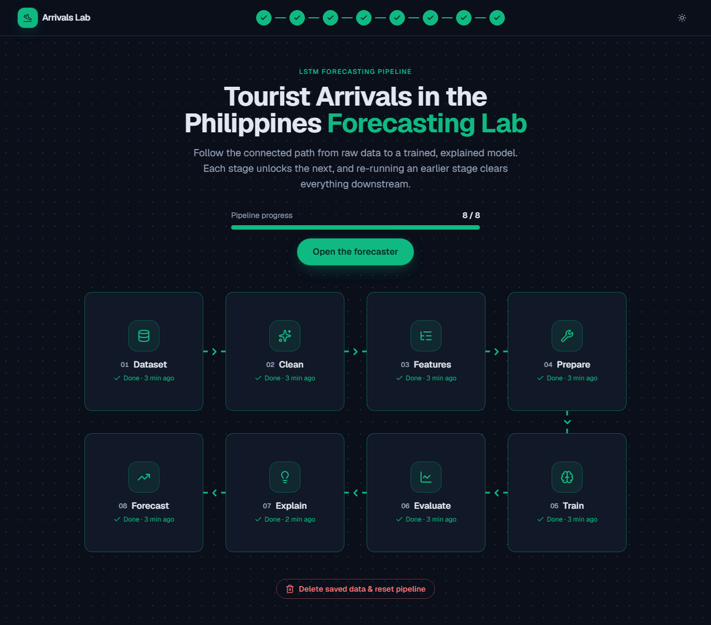
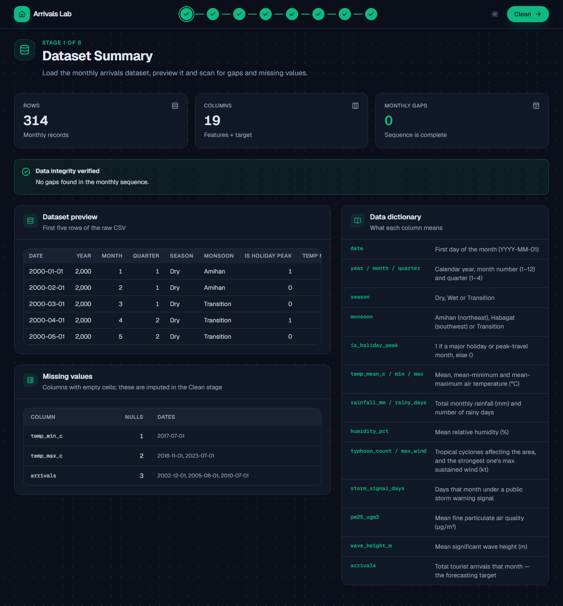
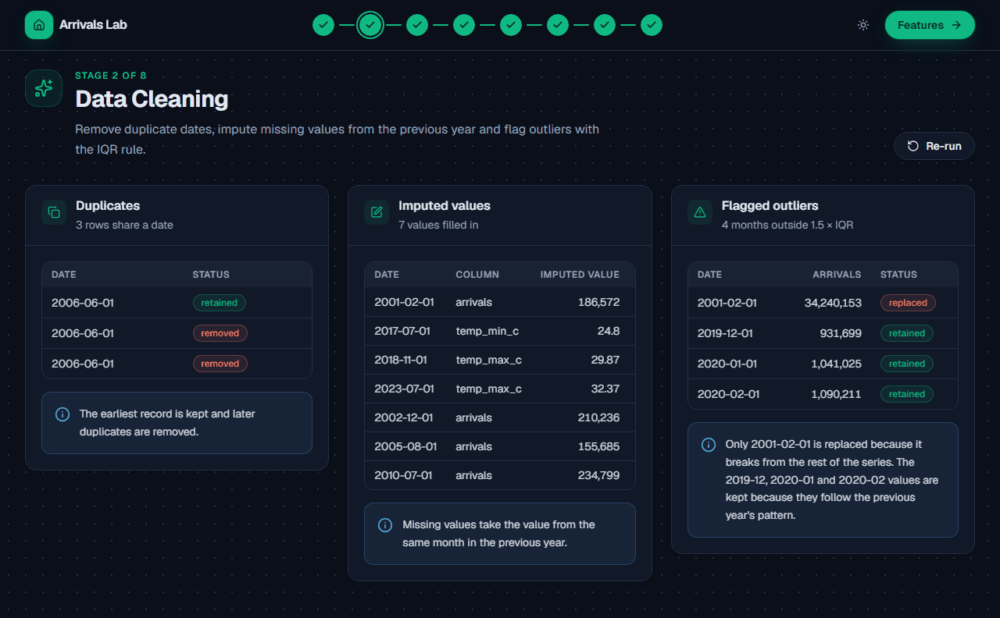
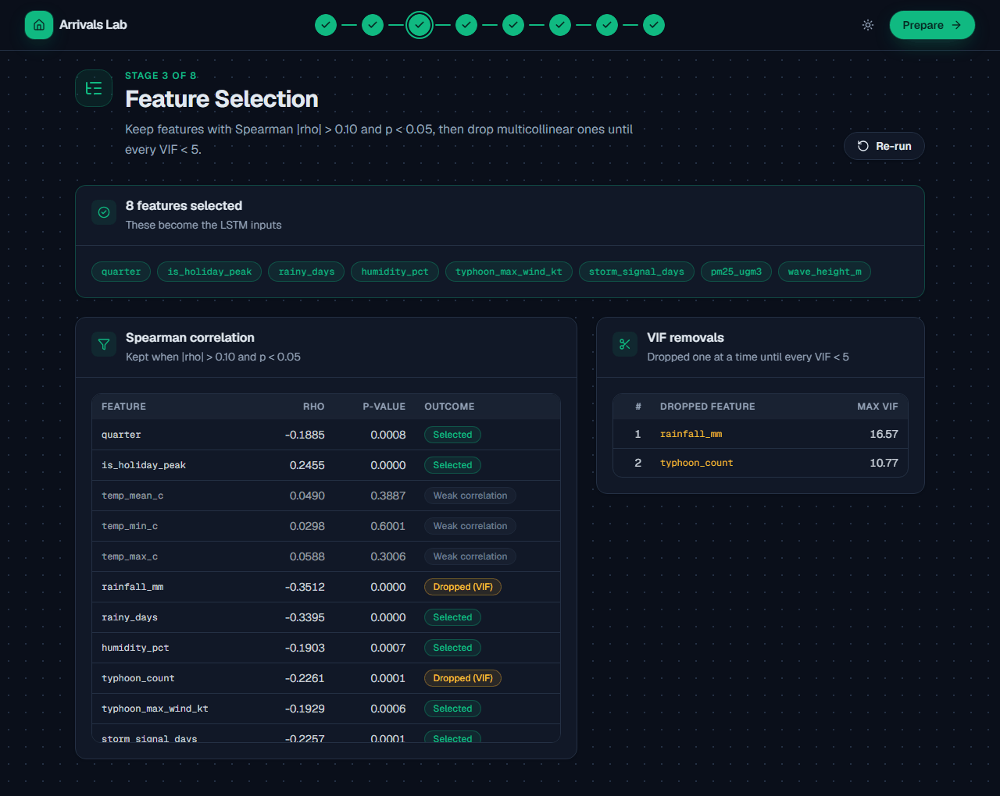
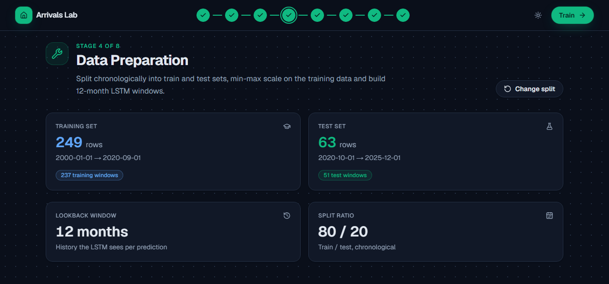
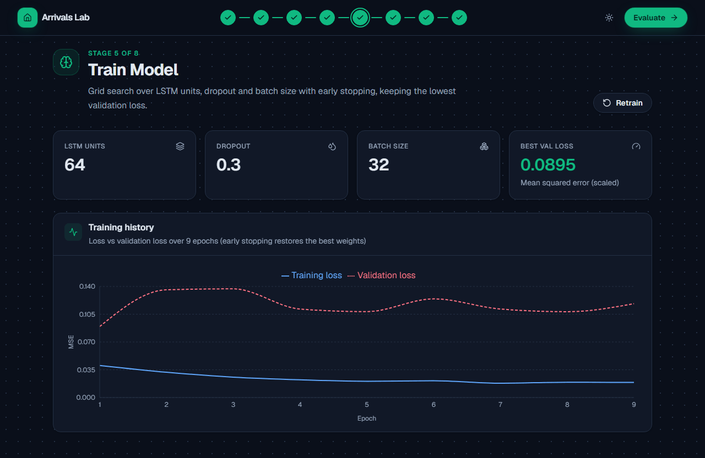
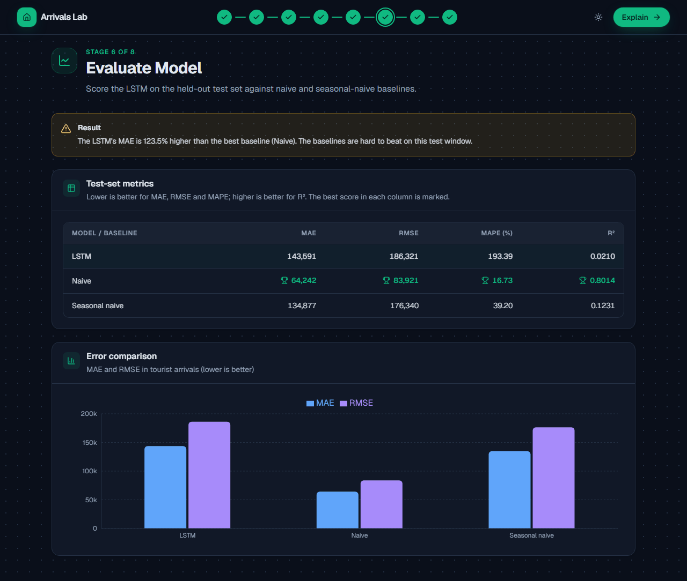
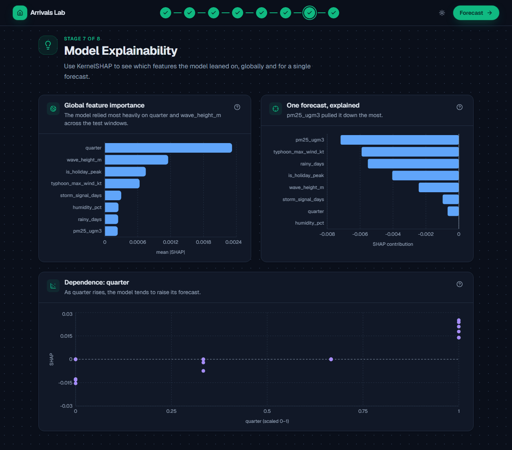
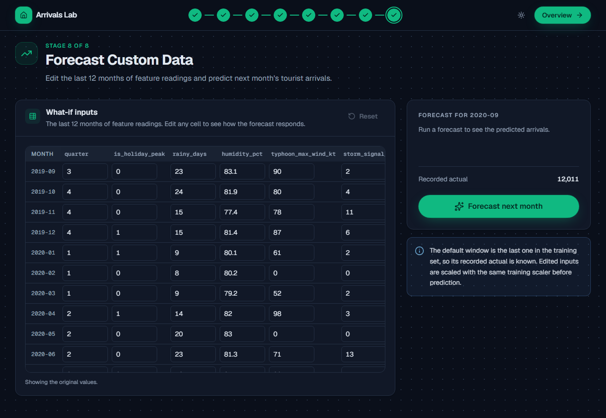
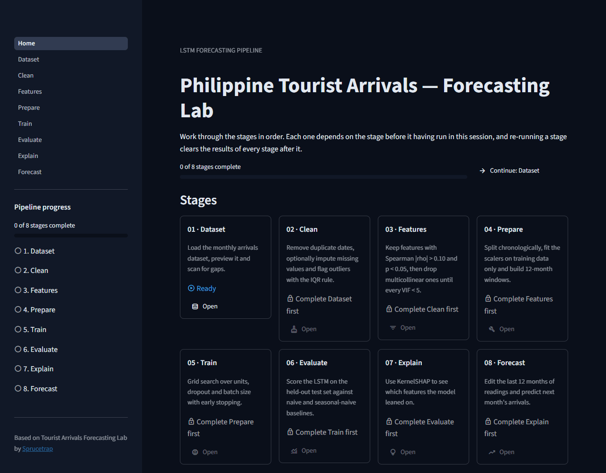

<div align="center" id="top">


# Tourist Arrivals Forecasting Lab

**An eight-stage LSTM pipeline that forecasts monthly tourist arrivals in the Philippines, from raw CSV to explained forecast.**


[](LICENSE)

[](https://github.com/Jevoel16/tourist-arrivals-app/actions/workflows/ci.yml)


</div>

---

## Table of contents

- [About](#about)
- [Features](#features)
- [Tech stack](#tech-stack)
- [Prerequisites](#prerequisites)
- [Installation](#installation)
- [Configuration and environment variables](#configuration-and-environment-variables)
- [Usage](#usage)
- [Documentation](#documentation)
- [Project structure](#project-structure)
- [Scripts](#scripts)
- [Contributing](#contributing)
- [License](#license)
- [Author](#author)

---

## About

The repository contains the same machine learning pipeline in two forms:

1. **The graded baseline:** a Streamlit multipage app (`Home.py` + `pages/`). All state lives in the Streamlit session.
2. **The advanced extension:** a FastAPI backend (`backend/`) that runs the pipeline and saves each stage's artifacts to disk, plus a Next.js frontend (`frontend/`) that drives it.

Both follow the same eight stages: **Dataset → Clean → Features → Prepare → Train → Evaluate → Explain → Forecast**.

<p align="right"><a href="#top">back to top ↑</a></p>

---

## Features

**Both apps**
- **Ordered stages.** A stage is locked until the one before it is done. Re-running a stage clears every stage after it.
- **Matching light and dark themes.** Both apps share one emerald palette.
- **Labelled charts.** Every chart has axis titles, readable tooltips and colours that work in both themes.

**Next.js frontend**
- **Pipeline overview.** A "snake" flowchart on desktop and a vertical timeline on mobile. It shows a progress bar, a *Continue* button, and each stage as done, up next, ready or locked, with the reason it's locked.
- **Sticky header.** Includes an eight-step progress stepper with completion times, an "API offline" indicator, a theme toggle and a *Next stage* button.
- **Consistent stage pages.** Every page has locked, loading, error-with-retry and done states. Long runs (Train, Explain) show an elapsed-time counter.
- **Forecast what-if editor.** An editable grid labelled by month. Empty cells are flagged and block the forecast, and a reset button restores the defaults. The prediction is compared with the recorded actual.
- **Accessible.** Keyboard and touch tooltips, a focus-trapping reset dialog, a skip link and visible focus rings. It also respects reduced-motion settings. Pressing <kbd>Esc</kbd> returns to the overview, except while you're typing.

**FastAPI backend**
- **Typed API.** Response models are documented at `/docs`, and inputs are validated (`train_ratio` bounds, forecast grid shape).
- **Clear errors.** A missing prerequisite returns `{detail, stage}`. Unexpected errors are logged and returned as a readable 500 with CORS headers.
- **Status details.** `GET /api/status/details` reports per-stage completion timestamps.

**Streamlit baseline**
- **Shared page layout.** A header on every page, a live sidebar progress list, and gates that link to the stage you need to run.
- **Richer results.** Metrics, tabs, formatted tables and Altair charts. Training shows live progress for each grid configuration.

<p align="right"><a href="#top">back to top ↑</a></p>

---

## Tech stack

| Layer | Technologies |
|---|---|
| Frontend | Next.js 16.3.5 (App Router), React 19.2.8, TypeScript 5.9.3, Tailwind CSS 4.3.3, framer-motion 13.4.0, Recharts 3.10.1, lucide-react 1.47.0, next-themes 0.4.6, axios 1.20.0 |
| Backend | FastAPI 0.141.1, Pydantic 2.13.5, Uvicorn 0.53.0 |
| ML | TensorFlow / Keras 2.21.0, scikit-learn 1.9.1, SHAP 0.52.0, statsmodels 0.15.0, SciPy 1.18.1, pandas 3.0.6, NumPy 2.5.3 |
| Baseline UI | Streamlit 1.64.0, Altair 6.3.0 |

<p align="right"><a href="#top">back to top ↑</a></p>

---

## Prerequisites

- **Python 3.10+** (developed on 3.13)
- **Node.js 20+** and **npm** (developed on Node 22)
- About 2 GB of free disk space for TensorFlow

<p align="right"><a href="#top">back to top ↑</a></p>

---

## Installation

Clone the repository:

```bash
git clone https://github.com/Jevoel16/tourist-arrivals-app.git
cd tourist-arrivals-app
```

**Streamlit baseline** (from the repository root):

```bash
python -m venv .venv
# Windows: .venv\Scripts\activate    macOS/Linux: source .venv/bin/activate
pip install -r requirements.txt
```

**FastAPI backend:**

```bash
cd backend
python -m venv .venv
# Windows: .venv\Scripts\activate    macOS/Linux: source .venv/bin/activate
pip install -r requirements.txt
```

**Next.js frontend:**

```bash
cd frontend
npm install
```

<p align="right"><a href="#top">back to top ↑</a></p>

---

## Configuration and environment variables

Both services work with no configuration. Copy the example files only to change the defaults.

| File | Variable | Default | Purpose |
|---|---|---|---|
| `frontend/.env.local` (from `.env.example`) | `NEXT_PUBLIC_API_URL` | `http://localhost:8000/api` | Base URL of the FastAPI backend |
| `backend` shell environment (see `.env.example`) | `ALLOWED_ORIGINS` | `http://localhost:3000` | Comma-separated CORS origins |
| `backend` shell environment | `LOG_LEVEL` | `INFO` | Python logging level |

The backend reads variables straight from the process environment, so it doesn't load `.env` files itself. Set them in your shell, for example `export ALLOWED_ORIGINS=http://localhost:3000`, or on Windows PowerShell `$env:ALLOWED_ORIGINS="http://localhost:3000"`.

The Streamlit theme lives in `.streamlit/config.toml`.

<p align="right"><a href="#top">back to top ↑</a></p>

---

## Usage

### Streamlit baseline

```bash
streamlit run Home.py
```

Open `http://localhost:8501`. On **Home**, click **Continue: Dataset**, then work through the pages in the sidebar:

1. **Dataset** loads the CSV automatically. It shows the row count, date range, gaps, a preview and the arrivals chart.
2. **Clean:** tick *Impute missing values* and click **Run cleaning**. Feature selection needs complete data.
3. **Features:** click **Run Spearman + VIF**.
4. **Prepare:** choose the split with the slider, then click **Prepare data**.
5. **Train:** click **Train & tune** and watch the eight grid configurations run.
6. **Evaluate:** click **Score on the test set**.
7. **Explain:** click **Compute SHAP values** (about a minute).
8. **Forecast:** edit the table, then click **Forecast next month**.

State is per browser session. Reloading the page starts a fresh session.

### FastAPI + Next.js

Start the backend from inside `backend/`. Its imports are relative to that folder.

```bash
cd backend
uvicorn main:app --reload --port 8000
```

In a second terminal, start the frontend:

```bash
cd frontend
npm run dev
```

Open `http://localhost:3000` and click **Start with Dataset**. Each stage page has one primary button (*Load dataset*, *Run cleaning*, *Split & scale*, *Train & tune*, and so on). When a stage is done, the header's **Next** button takes you to the following stage. Results are saved under `backend/store/`, so they survive reloads. To start over, click **Delete saved data & reset pipeline** on the overview.

You can also call the API directly:

```bash
curl http://localhost:8000/api/status/details
```

```bash
curl -X POST http://localhost:8000/api/prepare -H "Content-Type: application/json" -d '{"train_ratio": 0.8}'
```

<details>
<summary><strong>API endpoints</strong></summary>

| Method | Path | Description |
|---|---|---|
| GET | `/api/status` | `{stage: bool}` for all eight stages |
| GET | `/api/status/details` | `{stage: {done, updated_at}}` |
| DELETE | `/api/reset/{stage}` | Deletes that stage's artifact and everything downstream (404 for unknown stages) |
| GET | `/api/dataset` | Loads the CSV; returns the summary, preview, missing months and missing values |
| GET / POST | `/api/clean` | Cleaning report (the POST body is `{impute_nulls}`) |
| GET / POST | `/api/features` | Spearman results, VIF log and selected features |
| GET / POST | `/api/prepare` | Split report (the POST body is `{train_ratio}`, 0.5–0.95) |
| GET / POST | `/api/train` | Best params and loss history |
| GET | `/api/evaluate` | MAE, RMSE, MAPE and R² for the LSTM, naive and seasonal-naive models |
| GET | `/api/explain` | Global and local SHAP values and the dependence plot data |
| GET | `/api/forecast-default` | Last training window, month labels and recorded actual |
| POST | `/api/forecast` | `{edited_data: number[lookback][features]}` → `{prediction}` |

Interactive docs: `http://localhost:8000/docs`.

</details>

<p align="right"><a href="#top">back to top ↑</a></p>

---

## Documentation

Screenshots from the running app after a full pipeline run (dark theme, 1280px wide). Interactive API docs are served at `http://localhost:8000/docs`.

<details open>
<summary><strong>Screenshot gallery</strong></summary>

<table>
  <tr>
    <td width="50%" valign="top"><br /><strong>Overview.</strong> The overview: pipeline progress, a *Continue* button and the eight stages as a flowchart.</td>
    <td width="50%" valign="top"><br /><strong>1 · Dataset.</strong> Dataset: row and column counts, gap check, a preview, missing values and the data dictionary.</td>
  </tr>
  <tr>
    <td width="50%" valign="top"><br /><strong>2 · Clean.</strong> Clean: duplicates removed, missing values imputed and outliers flagged.</td>
    <td width="50%" valign="top"><br /><strong>3 · Features.</strong> Features: Spearman correlation filter and the VIF elimination log.</td>
  </tr>
  <tr>
    <td width="50%" valign="top"><br /><strong>4 · Prepare.</strong> Prepare: the chronological split and window counts.</td>
    <td width="50%" valign="top"><br /><strong>5 · Train.</strong> Train: the best grid-search configuration and its loss curves.</td>
  </tr>
  <tr>
    <td width="50%" valign="top"><br /><strong>6 · Evaluate.</strong> Evaluate: test-set metrics against the naive and seasonal-naive baselines.</td>
    <td width="50%" valign="top"><br /><strong>7 · Explain.</strong> Explain: global and local SHAP feature importance.</td>
  </tr>
  <tr>
    <td width="50%" valign="top"><br /><strong>8 · Forecast.</strong> Forecast: edit the last 12 months and predict next month's arrivals.</td>
    <td width="50%" valign="top"><br /><strong>Streamlit baseline.</strong> The Streamlit baseline's home page, with stage cards and the sidebar progress list.</td>
  </tr>
</table>

</details>

<p align="right"><a href="#top">back to top ↑</a></p>

---

## Project structure

<details>
<summary><strong>Show tree</strong></summary>

```text
tourist-arrivals-app/
├── .github/workflows/ci.yml  # CI: lint, type-check, build, py_compile
├── Home.py                  # Streamlit home: progress, stage cards, reset
├── ui.py                    # Streamlit shared helpers (stages, header, sidebar, gates, charts)
├── pages/                   # Streamlit stages 1–8 (pipeline logic inline)
├── .streamlit/config.toml   # Streamlit theme
├── data/tourist_arrivals.csv
├── docs/images/             # README screenshots
├── requirements.txt         # Streamlit dependencies
├── backend/
│   ├── main.py              # App, CORS, error handlers, logging
│   ├── config.py            # Env settings
│   ├── errors.py            # StageNotReady + duration logging
│   ├── schemas.py           # Pydantic request/response models
│   ├── state_manager.py     # File artifact store; saving clears downstream
│   ├── routers/pipeline.py  # /api routes
│   ├── services/            # One module per stage
│   └── .env.example
└── frontend/
    ├── .env.example
    └── src/
        ├── app/             # layout, overview (page.tsx) and one folder per stage
        ├── components/      # AppHeader, StagePage, PipelineStatusProvider, TransitionWrapper, ThemeToggle
        │   ├── ui/          # Button, Card, Alert, Badge, DataTable, StatCard, Spinner, InfoTooltip, Modal
        │   └── charts/      # ChartCard, chartTheme (CSS-variable colours)
        ├── hooks/           # useStage (stage lifecycle), useElapsed
        └── lib/             # api client, stage registry, types, formatting
```

</details>

<p align="right"><a href="#top">back to top ↑</a></p>

---

## Scripts

| Where | Command | What it does |
|---|---|---|
| `frontend/` | `npm run dev` | Dev server on port 3000 |
| `frontend/` | `npm run build` | Production build |
| `frontend/` | `npm run start` | Serve the production build |
| `frontend/` | `npm run lint` | ESLint (Next.js core-web-vitals + TypeScript) |
| `backend/` | `uvicorn main:app --reload --port 8000` | API with auto-reload |
| root | `streamlit run Home.py` | Streamlit baseline on port 8501 |

<p align="right"><a href="#top">back to top ↑</a></p>

---

## Contributing

1. Create a branch with a type prefix, for example `feat/short-description` or `fix/short-description`.
2. Use [Conventional Commits](https://www.conventionalcommits.org/). End the subject with the bumped SemVer version, for example `feat: add CSV export (v1.4.0)`.
   - A breaking change bumps the minor version while the project is `0.x`, a `feat` bumps the minor version, and anything else bumps the patch version.
   - Keep `frontend/package.json` and the README version badge in sync.
3. Run the same checks as CI before each commit. There are no automated tests yet.

   ```bash
   cd frontend && npm run lint && npx tsc --noEmit && npm run build
   ```

   ```bash
   python -m py_compile Home.py ui.py pages/*.py backend/*.py backend/routers/*.py backend/services/*.py
   ```

   CI (`.github/workflows/ci.yml`) runs these on every push and pull request to `main`, on Node 22 (`frontend/.nvmrc`) and Python 3.13.
4. Update this README with every change, including the version badges when dependencies change. Retake a screenshot in `docs/images/` when its screen changes.

<p align="right"><a href="#top">back to top ↑</a></p>

---

## License

Licensed under the **Sprucetrap Source-Available License 1.0**. You may use, study and modify the project for non-commercial purposes, with visible credit, and you must mark any changes you make. Commercial use needs written permission. See [LICENSE](LICENSE).

Based on Tourist Arrivals Forecasting Lab by Sprucetrap (https://github.com/Jevoel16).

<p align="right"><a href="#top">back to top ↑</a></p>

---

## Author

**Sprucetrap** ([@Jevoel16](https://github.com/Jevoel16)). Built as a machine learning laboratory exercise.

<p align="right"><a href="#top">back to top ↑</a></p>
